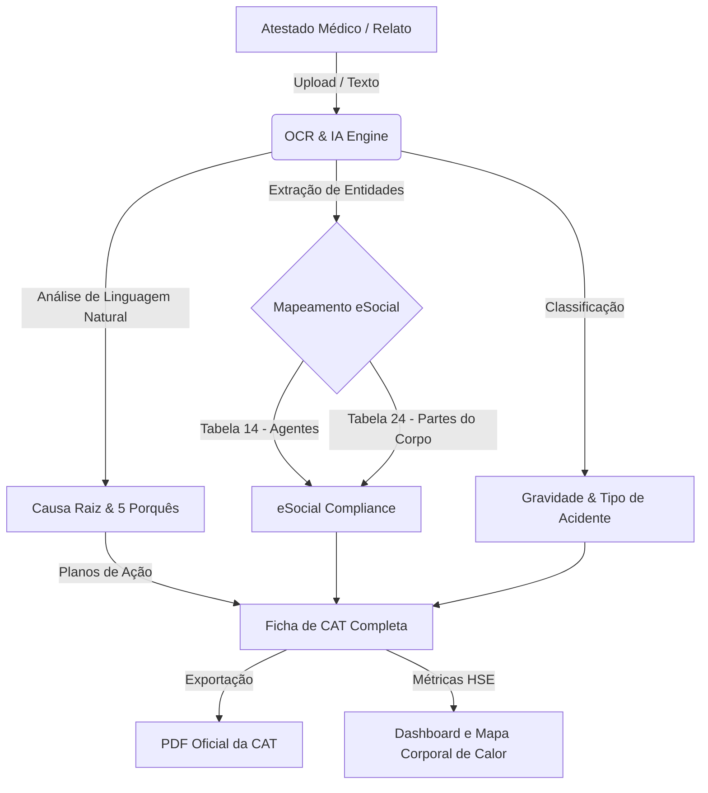

# 🛡️ SafeCAT AI - Inteligência Artificial para Gestão Preventiva de Acidentes

[](https://python.org)
[](https://streamlit.io)
[](https://www.gov.br/esocial)
[](https://docker.com)
[](https://kubernetes.io)
[](https://opensource.org/licenses/MIT)

> **Projeto Campeão de Hackathon (SESMT & Indústria 4.0)**: Um software SaaS inteligente projetado para eliminar a burocracia do preenchimento da **Comunicação de Acidente de Trabalho (CAT)**, mapear automaticamente dados para o **eSocial**, gerar investigações automáticas de causa raiz por IA e fornecer insights preventivos de saúde ocupacional.

---

## 📖 Sumário
- [O Problema Real](#-o-problema-real)
- [A Solução SafeCAT AI](#-a-solução-safecat-ai)
- [Arquitetura de Fluxo (Mermaid)](#%EF%B8%8F-arquitetura-de-fluxo)
- [eSocial Compliance](#-esocial-compliance)
- [Recursos de Destaque](#-recursos-de-destaque)
- [Instalação Local](#-instalação-local)
- [Deploy via Docker & Kubernetes](#-deploy-via-docker--kubernetes)

---

## 🚨 O Problema Real
Preencher uma CAT no Brasil é um gargalo operacional crítico nas empresas:
1. **Burocracia Excessiva:** Profissionais de SESMT (Segurança e Medicina do Trabalho) gastam horas classificando lesões, descobrindo o código de CID-10 e as tabelas correspondentes do governo.
2. **Custos Jurídicos e Multas:** O preenchimento incorreto ou o atraso na entrega da CAT ao eSocial gera multas severas à empresa.
3. **Falta de Aprendizado Organizacional:** Os relatórios de acidentes são preenchidos e arquivados. Quase nenhuma empresa executa uma investigação sistemática de causa raiz (ex: *5 Porquês*) em pequenos incidentes, perdendo a oportunidade de evitar acidentes fatais.

---

## 💡 A Solução SafeCAT AI
O **SafeCAT AI** automatiza o processo burocrático e ativa a prevenção inteligente através de IA Generativa:
- **OCR de Atestados Médicos:** Parsing inteligente por IA de atestados em imagem/PDF para preencher automaticamente paciente, CRM médico, dias de afastamento e CID-10.
- **Enquadramento eSocial Automatizado:** Tradução em tempo real de diagnósticos para as Tabelas 14 e 24 do eSocial.
- **Investigação Preventiva via IA (5 Porquês):** A IA lê o relato simples do supervisor e estrutura uma árvore completa de 5 Porquês com sugestão na hierarquia de controles (EPIs, Engenharia de Segurança, Administrativo).
- **Mapa de Calor Corporal (Injury Body Map):** Visualização interativa que aponta em um mapa de calor quais partes do corpo são mais vitimadas, permitindo atuações preventivas em EPIs e proteções mecânicas (NR-12).

---

## 🖥️ Arquitetura de Fluxo



---

## 📋 eSocial Compliance
O SafeCAT AI foi arquitetado sob as especificações do **Leiaute S-2210** do eSocial:
- **Tabela 24:** Codificação de Parte do Corpo Afetada (Cabeça, Tronco, Membros Superiores/Inferiores, Regiões Múltiplas).
- **Tabela 14:** Agente Causador e Natureza da Lesão.
- **Classificações:** Mapeamento em Acidente Típico, Trajeto ou Doença Ocupacional.

---

## ✨ Recursos de Destaque
- **Interface Premium Cyberpunk Slate:** Desenvolvida com gradientes em Ciano Neon, design limpo, responsivo e adaptado para displays industriais.
- **Geração de PDF Offline:** Relatório oficial da CAT gerado no backend com `reportlab`, permitindo assinaturas e auditoria física.
- **Investigação Ishikawa Integrada:** Mapeamento de medidas preventivas com foco na substituição e engenharia antes de propor apenas EPIs.

---

## 🚀 Instalação Local

### 1. Clonar o Repositório
```bash
git clone https://github.com/codebyjuliamendes/ia-para-CAT-engenharia.git
cd ia-para-CAT-engenharia
```

### 2. Instalar Dependências
```bash
pip install -r requirements.txt
```

### 3. Executar o Streamlit
```bash
streamlit run app.py
```
Acesse [http://localhost:8502](http://localhost:8502) no seu navegador.

---

## 🐳 Deploy via Docker & Kubernetes

### Usando Docker Compose
Suba o container isolado na porta `8502` com um comando:
```bash
docker-compose up --build
```

### Usando Kubernetes
Aplique as configurações de microsserviço no cluster local/nuvem:
```bash
kubectl apply -f k8s/deployment.yaml
kubectl apply -f k8s/service.yaml
```
O serviço estará acessível no NodePort `30852`.
